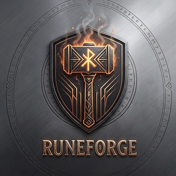

# Runeforge

<p align="center">
  
</p>

Runeforge turns tickets into tested, merged changes by running coding-agent CLIs (Claude Code,
Codex, Aider) through a fixed workflow:

```
task → plan (spec + acceptance tests) → code → test → locked-test check → branch, PR, merge
```

It is an addition to the coding-agent ecosystem, not a replacement: the agent CLIs do the
coding; Runeforge gives them durable status, isolation, locked acceptance tests and an audit trail,
using your own database and git.

- **Messages in a database.** Agents never call each other. Each role claims commands from a
  `runeforge_messages` table (SQLite on one host, PostgreSQL for many) and replies to a
  supervisor that applies the workflow.
- **Git as the ledger.** Each task gets a branch (`runeforge/<task>`); each attempt is one
  commit with `Agent-Task` / `Agent-Message` trailers linking it back to the database.
- **Merged by default.** A task that passes its tests and the locked-test check is merged into
  the base branch: through its pull request on GitHub, directly for other remotes and local
  repositories. The next task starts from the merged result. Set `manual_merge: true` to leave
  branches and pull requests for a person to merge instead (see [Merging](#merging)).
- **Isolation.** Agent CLIs and test suites run in a throwaway container with no git, GitHub,
  JIRA or database credentials. The host turns the agent's patch into a commit itself.
- **Liveness.** Claims are leased and heartbeated. Stalled work is requeued, and dead-lettered
  (task `blocked`) after three failed deliveries.

## Usage

```sh
runeforge "Build a CLI that converts CSV to JSON, with tests"   # a prompt
runeforge plan.md                                               # a markdown task list
runeforge plan.md -d ~/code/my-app                              # iterate on an existing project
```

- A single word that isn't a command or a file is refused as a likely typo; use
  `runeforge build WORD` to build from a one-word prompt.
- **Without `-d`/`--dir`**, Runeforge asks for a directory name, creates it as a new git
  repository, builds there and merges each step into `main`.
- **With `-d DIR`**, it works on `runeforge/<name>` branches in that repository and merges them
  into the branch you had checked out. Your checkout is fast-forwarded to match, as long as you
  haven't left uncommitted changes in it; otherwise the work stays on its branch. It refuses to
  start if `DIR` has uncommitted changes. A directory that isn't a git repository yet can be
  initialised on the spot.
- **With `manual_merge: true`**, nothing is merged: the whole run builds on one
  `runeforge/<name>` branch, a new project is left checked out on it, and `-d` leaves your
  checkout alone.
- **Task lists:** each unchecked top-level list item (`- item`, `- [ ] item`, `1. item`) is one
  step, built in order, each on its own branch merged before the next starts (on one shared
  branch with `manual_merge: true`); indented lines and nested sub-bullets belong to the item above, checked
  items (`- [x]`) are skipped, and the rest of the file is passed along as context. A file
  without at least two list items, or a prompt, is one step. A failed step stops the run.
- **Steps per task:** each step (one ticket) is one task, so every task has one clear deliverable
  that the ledger tracks (see "Ledger" below). Front matter `steps: N` makes at most N tasks by
  grouping consecutive steps.
- **Each step:** the planner writes a spec, acceptance tests (which become locked) and any
  scaffolding needed to run them, and says in `.runeforge/project.json` how to run the tests,
  how to run the project (`run_command`) and which tools they need. The coder then works until
  the tests pass (up to `max_attempts`).
- **One conversation per step:** the coder's attempts continue the planner's conversation (Claude
  Code resumes its session; Runeforge's ruby_llm agent gets its transcript back from the database),
  so the coder doesn't read the whole project again. A re-plan starts a new one. `agent.conversation:
  none` gives every run a conversation of its own.
- **Contested tests:** a coder that finds a locked test can't pass as written says why in
  `.runeforge/contest.md`, and the step goes straight back to the planner.
- **Lessons:** what went wrong in a step (a rejected plan, contested or wrong tests, a failed step) is
  remembered, and the planner of a similar later step sees the closest few as known pitfalls: its
  own plan's, and other plans' only when they match closely (`memory.lesson_bar`). They're matched
  by shared words, or by meaning with `memory.embedding_model`.
- **Ledger:** each step hands the next one what it learned, so later agents don't re-learn the
  project or rebuild what's done (see "Ledger" below).
- **Runnable results:** an existing project keeps its own launch method; Runeforge records it
  and changes nothing about it. A new project gets a README with a How to run section (npm
  projects an `npm start` script), and the reviewer rejects work whose docs don't contain the
  command Runeforge defined. `runeforge build` ends by printing it, and `runeforge repo set NAME
  --run-command ...` changes it. The conventions for common web and mobile stacks are in
  [docs/run-conventions.md](docs/run-conventions.md).
- **The project's own environment:** a project with a `.devcontainer/devcontainer.json` is
  built in it (see [Devcontainers](#devcontainers)): its image, with its gems installed in
  advance, and the services it depends on (Postgres, Redis, Selenium, ...) started beside every
  run. Before planning, Runeforge checks the Ruby and Node versions the project pins
  (`.ruby-version`, `.tool-versions`, `.nvmrc`) against the image and stops, without spending
  tokens, if they don't match.
- **Missing tools:** other projects run in the general-purpose image `runeforge/general:latest`
  (Python, Node, Ruby 3.3, Go, build tools, git, Claude Code). When a step needs something else,
  Runeforge asks which apt packages to add and builds a per-project image on top of it (inbox
  plans built with `runeforge build -d DIR` ask too). With `sandbox.mode: none` it asks you to
  install the tool yourself instead.
- It runs in the foreground and prints each step as it happens. Ctrl-C stops it and discards
  the step in progress; finished steps stay merged (or on the branch, with `manual_merge`).

Configuration and data live in `~/.runeforge/`: settings in `~/.runeforge/runeforge.yml`, plus
the SQLite database, clones, logs and workspaces. The directory you run `runeforge` from doesn't
change its settings. `-c PATH` (or `RUNEFORGE_CONFIG=PATH`) reads another config file, and
`-db URL` (or `--database URL`) points at a different database.

## Setup and background mode

From a checkout, one command installs gems and sets everything up:

```sh
bin/setup                                   # = bundle install + runeforge init
```

With the gem installed, `runeforge init` does the same setup. Each step checks what is already
in place, so it is safe to run again:

1. Writes `~/.runeforge/runeforge.yml` (unless it exists) from flags such as `--database`, `--sandbox`, `--model`.
2. Checks git, and for a PostgreSQL URL starts the server via Homebrew when needed and creates the database.
3. Runs migrations.
4. Starts Docker Desktop (macOS), the Podman machine, or `systemctl start docker` when the sandbox needs it.
5. Builds the example agent image `runeforge/general:latest` if it is missing (`--skip-image` to skip).
6. Registers a repository if you pass `--repo-url URL --test-command CMD`.
7. Warns about missing secrets.
8. Starts the supervisor and one worker per `workers` entry in the background, then waits for
   them to register (`--no-start` to skip).

```sh
runeforge init --repo-url git@github.com:acme/api.git --repo api \
  --test-command "bundle exec rspec" --setup-command "bundle install"

runeforge ps                                         # background processes and their logs
runeforge task create --repo api --ticket DEV-101    # text fetched from JIRA when configured
runeforge task create --repo api --spec change.md    # or from a file
runeforge watch DEV-101
runeforge down                                       # stop the background processes
```

Background processes keep pid files in `<home>/run` and logs in `<home>/logs/daemons`. To run
them in the foreground instead, use `runeforge supervisor` and `runeforge worker --role ...`.

Environment variables used on the host: `RUNEFORGE_LLM_API_KEY` (a separate, spend-limited key;
the only secret that enters a container), `GITHUB_TOKEN`, `JIRA_EMAIL`, `JIRA_API_TOKEN`,
`RUNEFORGE_WEBHOOK_SECRET`. Git pushes use the host's normal git credentials.

**Models and API keys:** set the model in `runeforge.yml`. With an API key, any provider runs
on Runeforge's own agent, built on the [ruby_llm](https://rubyllm.com) gem
(`lib/runeforge/agent_runner.rb`). It runs in the sandbox with tools to list, read, search,
write and edit files and to run commands in the workspace. Each role can use its own model:

```yaml
agent:
  model: claude-sonnet-5-5          # the default for every role
  roles:
    planner: { model: gemini-pro-latest }
```

| Model (examples) | Provider | Key (host variable) |
|---|---|---|
| `claude-sonnet-5-5`, `claude-opus-5` | anthropic | `RUNEFORGE_ANTHROPIC_API_KEY` |
| `gemini-pro-latest`, `gemini-flash-latest` | gemini | `RUNEFORGE_GEMINI_API_KEY` |
| `gpt-5.6`, `o3` | openai | `RUNEFORGE_OPENAI_API_KEY` |
| `deepseek-chat`, `grok-4`, `codestral-latest`, `sonar-pro` | deepseek, xai, mistral, perplexity | `RUNEFORGE_<PROVIDER>_API_KEY` |
| `openrouter/<model>` | openrouter | `RUNEFORGE_OPENROUTER_API_KEY` |
| any OpenAI-compatible service (Together, Groq, a local server) | `provider: openai` plus `api_base:` | the role's `key_env` |

`RUNEFORGE_LLM_API_KEY` also works for the default model's provider (never for another
provider's model). A role's own `key_env` comes first. Models ruby_llm can't price can be given
`pricing` (dollars per million tokens) so budgets still work, and `max_tool_calls` (200) stops
a run that never finishes. Runeforge stops before starting if a role's agent has no key.

`adapter: claude_code` (or `codex`, `aider`, `command`) runs that CLI instead. Claude models use
Claude Code automatically when the only credential is a Claude subscription token (below).

The agent image (`docker/Dockerfile.general`, Ruby 3.3 with ruby_llm, Node 22, Claude Code)
must be rebuilt after upgrading Runeforge:
`docker build -t runeforge/general:latest -f docker/Dockerfile.general docker`.

**Using a Claude subscription instead of an API key:** your normal Claude Code login lives on
your machine, so agents in a container can't see it. Create a long-lived token for them:

```sh
claude setup-token                          # opens a browser; prints the token
export CLAUDE_CODE_OAUTH_TOKEN=sk-ant-oat01-...   # add to your shell profile
```

With no `RUNEFORGE_LLM_API_KEY` set, Runeforge passes that token into the container (the
variable is `agent.oauth_token_env`). An API key wins when both are set. `runeforge build`,
`worker` and `up` stop before starting if a sandboxed agent has neither.

## Devcontainers

Runeforge reads `.devcontainer/devcontainer.json` (or `.devcontainer.json`) from the base branch:
an `image`, a `build` Dockerfile, or a `dockerComposeFile` with a `service`. It builds that image
once per version of the devcontainer files, the Dockerfile, the Gemfiles and `.ruby-version`, as
`runeforge/<repo>-dev:<hash>`, and adds a layer with Claude Code, ruby_llm and the project's gems
(`bundle install`). `runeforge build -d DIR` builds it before the first step, and background
workers before their first run in the project.

- **Services:** with a compose file, the services the main service `depends_on` that are plain
  images (`postgres:17`, `redis:7`, a Selenium browser) start on a private network next to every
  sandbox run, under their service names, and are removed after it. Their data starts empty
  each time, so the planner's `setup_command` prepares the database (`bin/rails db:prepare`).
  Services built from source aren't started.
- **Variables:** `containerEnv`, `remoteEnv` and the main service's `environment` are set in
  every run (`DB_HOST=postgres`, `REDIS_URL=...`). Values that use `${localEnv:...}` are left
  out.
- **Features:** applied when the [devcontainer CLI](https://github.com/devcontainers/cli) is
  installed. Without it, well-known features are installed as apt packages instead
  (`postgres-client`, `mysql-client`, `sqlite3`, `activestorage`, `github-cli`; Runeforge adds
  Node itself), and the others are skipped, with a warning.
- **Users:** tools run with the devcontainer's `remoteUser` login environment (from
  devcontainer.json or the image's `devcontainer.metadata` label), as the devcontainer CLI's
  `userEnvProbe` does, so Ruby and Node from version managers such as mise and rbenv are on
  `PATH`. The project's gems are installed in the image; if they don't install, the image
  doesn't build.
- An image set with `runeforge repo set NAME --image` takes precedence. If the image fails to
  build, the environment check fails with the end of the build log (in `~/.runeforge/logs/`)
  and, for a full disk or Docker storage errors, what to do. Background workers keep the last
  image that built, or the general image.

## Checking the build environment

`runeforge doctor -d DIR` checks a project the way its agents will use it, in the sandbox they
run in, and says what to fix for anything that fails:

```
Checking the build environment for /Users/you/resume_refiner
  ✓ docker         running (28.5.2)
  ✓ disk           15 GB free
  ✓ project image  runeforge/resume-refiner-50bba4-dev:ea745d87d253
  ✓ container      ruby 3.4.7, node 20.19.2
  ✓ versions       ruby 3.4.7 as pinned
  ✓ services       selenium, redis, postgres start and answer
  ✓ credentials    set for claude_code/claude-sonnet-5-5
  ✓ checkout       build-resume is clean; work is merged into it
Ready: agents and tests can run here.
```

`runeforge build -d DIR` and `resume -d DIR` run the same check before they read the inbox or
start a step, so a broken environment stops them before any tokens are spent and without
touching a plan. If the container runtime stops working during a step (Docker quits, its disk
fills up), the step stops at once, isn't counted as an attempt, and continues where it was on
the next run; background workers wait a minute and try again.

## Commands

| Command | What it does |
|---|---|
| `runeforge status TASK` | Task header plus every message, with heartbeat age for claimed work |
| `runeforge -d DIR status` | The project in DIR: whether it can be built here (see Platform apps), how it runs and merges, recent tasks, queued plans |
| `runeforge watch TASK` | Follows new messages until the task finishes |
| `runeforge tasks [--status S]` | Lists tasks |
| `runeforge workers` | Live workers, their current message and sandbox |
| `runeforge cancel TASK` | Stops a task; running workers kill their sandbox and discard results |
| `runeforge retry TASK --from-message N [--add-attempts K]` | Restarts coding from that message's commit |
| `runeforge logs TASK [--message N]` | Lists logs, or prints one |
| `runeforge init` | First-time setup; safe to repeat (see Quick start) |
| `runeforge up / down / ps` | Start, stop and list the background supervisor and workers |
| `runeforge webhook` | Serves `POST /webhooks/jira?token=…` for issues labelled `runeforge` |
| `runeforge dashboard [--port 9393]` | Serves the live dashboard (see below) |
| `runeforge warcamp [--port 9393]` | The same live view, drawn as an orc war camp |
| `runeforge repo set NAME [--run-command CMD] [--test-command CMD] [--require-run-docs]` | Change how a repository is tested and run |
| `runeforge config edit` | Opens `~/.runeforge/runeforge.yml` in `$VISUAL`/`$EDITOR` (creating it if needed), then checks it |
| `runeforge config path` / `config show` | The config file in use / the settings in effect, defaults included |
| `runeforge inbox [REPO] [--poll] [--all]` | The plans queued from each project's `runeforge/inbox/` |
| `runeforge items [REPO] [--plan NAME] [--tree]` / `runeforge show ITEM` | The ledger's plans, tickets and requirements; one item's links, code and tests (see Ledger) |
| `runeforge context index REPO` / `context search REPO QUERY` | Index a repository's code; show what the brief's code map would hand an agent |
| `runeforge build -d DIR [--retry]` / `runeforge resume -d DIR [--retry]` | Builds DIR's inbox plans in the foreground; `--retry` retries the failed ones |
| `runeforge doctor -d DIR` | Checks that DIR's agents and tests can run (see Checking the build environment) |
| `runeforge demo` | Dry-run agents forever, plus the dashboard; no LLM, git or network |
| `runeforge worker --role R --dry-run` | A worker whose agents only go through the motions |

## Roles

Every step moves through these roles. The supervisor routes messages between them; the planner,
the coder and, for UI changes, the UX reviewer run an agent. The other checks and the hand-off are
deterministic, so an agent never judges its own work and never runs next to your credentials.

| Role | Agent? | Responsibilities | Runs where | Can change code? |
|---|---|---|---|---|
| **Supervisor** | No | Reads each result and sends the next command according to the workflow; enforces attempt, token and time budgets; requeues work whose worker stopped heartbeating and blocks a task after repeated failures | Host | No |
| **Planner** | Yes | Writes the spec (`.runeforge/spec.md`), acceptance tests that fail until the step is built, and any scaffolding needed to run them; reports the test command, setup command and required tools in `.runeforge/project.json`. Its test files become locked | Sandbox | Yes: tests and scaffolding |
| **Operator** | No (a person) | Foreground runs only (`build`, and inbox plans built with `build -d` or `resume -d`): when the planner lists tools the sandbox lacks, or tests fail with "command not found", asks which apt packages to add and builds a per-project image (or, without a sandbox, asks you to install them) | Your terminal | No |
| **Coder** | Yes | Changes the code until the locked tests and the rest of the suite pass, using feedback from failed attempts. A patch that touches a locked test file is rejected | Sandbox | Yes, except locked tests |
| **Tester** | No | Runs the setup and test commands against the coder's commit in a fresh sandbox; the exit code is the verdict. Never writes files | Sandbox | No |
| **Reviewer** | No | Confirms every locked test file is byte-for-byte what the planner committed (by git object id) and that the change stays within size limits | Host | No |
| **UX reviewer** | Yes | Only for steps whose plan changes the UI. Starts the app in the sandbox, opens the screens the planner's UI brief (`.runeforge/ui.md`) names in a real browser (the project's Selenium service, else a headless browser in the image) at desktop and phone widths, screenshots each state and judges them against the brief and the app's existing screens. Blocker and major issues go back to the coder; minor ones become notes. Screenshots are kept under `logs/<task>/<message>-ux/`. If it can't run, the step is merged with a note saying so | Sandbox | No (its changes are discarded) |
| **Integrator** | No | Pushes the branch, opens or reuses the pull request on GitHub, comments on the JIRA ticket, and merges (unless `manual_merge`), using credentials that only exist on the host | Host | No |

A failed test run or rejected check goes back to the coder with the failure output, until the
task runs out of attempts or budget.

**UI changes:** the planner decides whether a step changes what people see or do. If it does, it
writes a UI brief (the screens and how to reach them, the states to check, the existing screens to
match, the widths) and a browser test for each user-facing path; the coder sees the brief too. A
plan's `ux_review:` front matter (`auto`, `always`, `never`) overrides that, and
`ux_review.enabled: false` in `runeforge.yml` turns the review off. Workers that run the reviewer
also run the UX reviewer.

**Test and setup commands:** the setup command runs before the tests in the same shell, so its
exports apply, and a setup command that fails is reported as that, not as failing tests. The
planner's check of its own plan runs both, so a setup command that isn't valid shell, or fails,
sends the plan back to the planner. At test time, a setup command that isn't valid shell goes
back to the planner without using coding attempts; one that fails goes to the coder, labelled,
since its changes can break setup (a migration, the schema). Commands are never shortened: one
over 1000 characters is sent back for the planner to put in a script. Commands a plan recorded
are replaced by later plans' commands; ones set with `runeforge repo add` or `repo set` stay.

## How a step runs

1. A worker claims a command and leases it; a heartbeat thread keeps the lease alive.
2. The commit is exported with `git archive` into a fresh workspace. The host's `.git` is never
   mounted.
3. Inside the container, a script snapshots the tree in a throwaway repo, runs the agent CLI
   with the prompt from `.runeforge/prompt.md`, and writes everything it changed to
   `.runeforge/changes.patch`. Dependency folders are never included, nor are new directories
   over 5 MB or new files over 1 MB (a browser downloaded by system tests, build output); the
   step's output lists what was left out.
4. The host reads the patch (refusing symlinks and oversized files), applies it to a temporary
   index of its own bare clone, checks it against the locked tests and size limits, and commits.
5. The result message, the task update and the claim completion are written in one transaction.

The planner's patch must include at least one test file (matching `test_globs`); those test
files become locked, while any scaffolding it adds does not. The coder's patch is rejected if it
touches a locked file, and the reviewer re-checks every locked file's git object id before the
branch is pushed and merged.

## Live dashboard

`runeforge dashboard` serves an HTML page (Puma, default `http://127.0.0.1:9393/`) that shows
each role's claimed and waiting work, its live output, and every task's progress, as it happens.
It watches the database, so it sees supervisors and workers on any host.

- **Events.** Every change that matters to a viewer (a message posted, claimed, heartbeated,
  done, requeued, dead-lettered or cancelled; a task updated; a worker starting or stopping) also
  writes a row to `runeforge_events`, in the same transaction. Running agents and test suites
  add `agent.output` rows, batched about twice a second. The supervisor prunes events older
  than `events.retention_hours`.
- **Protocol.** `GET /api/state` returns a snapshot and a `cursor`; `GET /api/events?after=CURSOR`
  is a Server-Sent Events stream of everything after it (`?task=ID` narrows it). Each frame's
  `id` is the event id, so a reconnecting `EventSource` resumes where it left off. PostgreSQL
  wakes the stream with `LISTEN`/`NOTIFY`; SQLite polls. `POST /api/tasks/ID/cancel` (with an
  `X-Runeforge-Dashboard: 1` header) stops a task.
- **Access.** It binds to 127.0.0.1. Set `RUNEFORGE_DASHBOARD_TOKEN` to require `?token=`.

**Dry run.** With `dry_run.enabled: true` (or `runeforge worker --dry-run`), every role claims
real messages but, instead of running an agent, narrates canned steps for 5-10 seconds
(`dry_run.min_seconds`/`max_seconds`) and replies with a made-up result. Some results are
failures (`dry_run.failure_rate`), so retries and failed tasks happen too. `runeforge demo` runs
a supervisor, dry-run workers for every role and a feeder that keeps three tasks in flight, all in
one process with its own `~/.runeforge/demo.db`, until Ctrl-C:

```sh
runeforge demo                         # then open http://127.0.0.1:9393/
runeforge demo --warcamp               # the same, as the war camp
runeforge demo --concurrency 5 --min-seconds 2 --max-seconds 4
```

**War camp.** `runeforge warcamp` serves the same data as an RTS-style orc camp. Each role has
a building, and each worker is an orc who leaves it for a job and brings the result back:
- the planner studies the signpost by the war tent and brings back a scroll
- coders chop trees beside the lumber camp and carry logs home
- the tester hammers at the forge's anvil and stores the ingot in the chest
- the reviewer shoots at the target by the watchtower
- the integrator loads crates at the stables and hauls them out along the south road

Failures play a hit animation. Banners show the number of jobs waiting. Click an orc for its
task and live output, or Cancel to stop its task. Drag to pan and scroll to zoom. The art is
third-party; see [CREDITS.md](CREDITS.md). To rebuild it after changing `art/`, run
`python3 script/build_warcamp_assets.py` (needs Pillow and NumPy).

## Inbox

Every project gets a `runeforge/` folder: new projects in their first commit, existing
repositories with the first task Runeforge merges into them. Commit a markdown plan to
`runeforge/inbox/` on the base branch and the background supervisor (`runeforge up`) builds it:

```
runeforge/
├── README.md
├── inbox/      # commit plans here
└── done/       # finished plans, with a summary of the tasks that built them
```

- **Order:** plans run one at a time per repository, in the order they arrived on the base
  branch: the position of the commit that added each file, following renames. File names only
  break ties, and file dates are never used.
- **Plans:** same format as `runeforge plan.md`: unchecked task-list items become tasks (one per
  item; see `steps:`), each on its
  own branch and merged before the next; any other file is one task. The last step's merge
  also moves the plan to `done/`.
- **Front matter** (optional): `after: other-plan` waits until that plan is done;
  `replaces: other-plan` unlocks that plan's acceptance tests; `steps: auto | each | N` sets
  how many tasks the steps become; `title`, `max_attempts`.
- **Changes:** edit a queued plan and it keeps its place; edit a running one and it restarts;
  edit a failed one (for example, check off the items that already merged) to queue it again
  at the back; delete one to drop or cancel it. Front matter keys Runeforge doesn't know (say,
  `retries:` for `max_attempts:`) are ignored with a warning.
- **Building in the foreground:** `runeforge build -d DIR` (or `runeforge -d DIR`) with no file
  or prompt builds DIR's inbox at the terminal, as `runeforge resume -d DIR` does once no build
  there is unfinished. Both run the environment check first (see [Checking the build
  environment](#checking-the-build-environment)) and start nothing until it passes.
- **When the environment is the problem:** a step that fails because of where it ran (the
  planner finds the toolchain missing, the pinned versions don't match, Docker stops working)
  doesn't fail its plan or use an attempt. The plan waits in the queue, `runeforge inbox` says
  what for, and the next `runeforge build -d DIR` continues it once the check passes. If the
  same step still can't run after a passing check, the plan fails with the agent's explanation
  of what it needs.
- **Retrying a failed plan:** `runeforge build -d DIR` offers to retry a plan that failed for any
  other reason, in its old place, from the step that failed (the steps before it stay merged);
  `--retry` retries them without asking.
- **Locked tests carry over:** each plan inherits the acceptance tests of every finished plan, so
  a plan that contradicts an earlier one fails its review instead of quietly breaking it.
- **Not merged:** if a plan's work can't be merged (branch protection, conflicts), the
  repository's queue pauses until that work lands or the plan is removed from the inbox. With
  `manual_merge: true`, plans stack on one shared `runeforge/inbox` branch instead, which starts
  over from the base branch once everything on it has landed.
- Coding agents can't change anything under `runeforge/`. The planner is told which plans are
  still queued, so it doesn't build their work early.

`runeforge inbox --poll` checks now rather than waiting `inbox.poll_seconds` (60). Both
dashboards show the queue. `inbox.enabled: false` turns it off. The design is in
[docs/plans/inbox.md](docs/plans/inbox.md).

## Merging

By default every task is merged once it passes:

- **GitHub remotes:** the integrator opens the pull request, then merges it through the API
  with `merge_method` (`merge`, `squash` or `rebase`; default `merge`). Branch protection still
  applies: if GitHub refuses (required reviews or checks, conflicts), the pull request is left
  open and the task finishes with a "not merged" warning.
- **Other remotes and local repositories:** there is no pull request, so the branch is merged
  directly: a fast-forward when nothing else landed, otherwise a merge commit built in
  Runeforge's own clone. Conflicts are never resolved automatically; the branch is left for you.
  If the base branch is checked out in a local repository, that checkout is fast-forwarded only
  when it has no uncommitted changes. Merged branches are deleted.

A task that wasn't merged is still `done`; `runeforge status TASK` shows the warning and its
`merged_sha` stays empty. `manual_merge` and `merge_method` can be set per project under
`projects:` in `runeforge.yml`, keyed by the project's directory, registered repo name or git
URL (`projects: { ~/code/payments: { manual_merge: true } }`). With `manual_merge: true`, Runeforge stops after
pushing the branch and opening the pull request, as it used to.

## Platform apps

Agents and tests run in a Linux container, which can't build iOS, macOS or Android apps: those
need Xcode on a Mac, or the Android SDK. Runeforge recognizes them from the project's files
(`*.xcodeproj`, an Apple-platform `Package.swift`, a `Podfile`, `AndroidManifest.xml`) or the
request ("iOS", "SwiftUI", "Android app", ...), and checks where they would be built:

- `runeforge build` explains and asks before starting.
- The planner checks again before its agent runs. An incompatible project fails planning with
  the fix instead of being rewritten in a language the sandbox has.
- The verdict is recorded on the repository; `runeforge -d DIR status` shows it alongside a
  fresh check.

To build an Apple app, run it on a Mac with the full Xcode app (not only the Command Line Tools)
and turn the sandbox off for that project: `projects: { ~/code/wordreel: { sandbox: none } }`.
Without a sandbox the agents run on your machine with full permissions (Claude Code with
`--dangerously-skip-permissions`, Codex without its own sandbox), so they can build, test and run
the simulator, and could run any other command as you. Use it only for projects you'd trust an
agent with.

## Ledger

Runeforge keeps a ledger in its database of what each step is for and what earlier steps left
for it. Agents never write to it: they read a brief built from it and leave a handoff file, and
Runeforge checks every claim against git before keeping it.

- **Items:** when an inbox plan starts, it becomes a plan item, one ticket per task-list item
  (each its own step), and a requirement per sub-bullet. A step claims its ticket; a ticket has
  one running owner, and a failed step gives it back for the retry.
- **Links and anchors:** the exact identifiers in a ticket (routes like `GET /api/x/:id`,
  `data-testid` values, file paths, symbols, snake_case fields) are its anchors. A new plan's
  tickets that share them with another plan's are linked as `duplicates`, `overlaps` or `extends`
  (finished work it says it changes), shown in the brief so a step builds on what's done instead
  of again. Plans are also linked by `blocks` (ticket order), `supersedes` (`replaces:`),
  `built-by`, `discovered-from` and `conflicts-with`.
- **The brief:** before the planner (and a coder that doesn't continue the planner's session)
  starts, Runeforge writes a brief into its prompt, within `ledger.brief_chars`: the step's
  requirements with their ids and status, related work, a code map with the best few chunks of
  code inline (from the code index below), the locked tests that already pin nearby behaviour,
  and facts earlier steps learned. The full ranked map and its chunks go to `.runeforge/context/`.
  The UX reviewer gets the project's earlier UX findings, to check they aren't back.
- **Handoffs:** the planner and the coder end by writing `.runeforge/handoff.json`: which tests
  pin each requirement, where its code is (path, symbol, a one-line note), facts (conventions,
  commands, layout, gotchas) and work found outside the step. Paths must exist at the commit,
  symbols and test names must be in those files; the rest is dropped. At merge the step's items
  close, the files it changed get pointers, older pointers to those files go stale, and its locked
  tests become coverage, with their names read from the files.
- **Already built:** when every requirement of a step was built by an earlier one (its handoff
  said so and named tests, and those tests passed at merge), the step runs the suite once and
  merges with no planner or coder session.
- **Conflicts:** a planner that finds the step contradicts what the project documents or tests
  marks it `conflict` with what it cites; the step stops with "needs a decision", isn't retried,
  and isn't taken for a broken build environment.
- **Discovered work:** work an agent found outside its step, with evidence (a file and line that
  exist, or a command), is committed with the step as `runeforge/inbox/found-*.md` with
  `after:` the current plan, so it queues behind it. It's dropped if the ledger already has it;
  at most `ledger.max_discovered` per plan; and a plan that was itself discovered work doesn't
  queue more (those wait as items, listed by `runeforge items`). Delete the file to drop it.
- **UX findings:** become facts later coders see first time; after `ux_review.max_rounds`
  rejected reviews a step merges with what's left as notes instead of looping.
- **Upkeep:** facts are kept by key (a repeat counts as a confirmation), at most
  `ledger.max_facts` per project, least used first out; closed items of plans more than
  `ledger.compact_after_plans` back keep only their title, close reason, links and pointers.

`runeforge items [REPO] [--plan NAME] [--tree]` lists the ledger; `runeforge show ITEM` shows an
item's text, owner, anchors, links, code pointers and covering tests.

**Code index:** a project's code is split into chunks (a function, a route handler, a component,
a test block) once per file version, keyed by git object id, so each commit only adds the files
it changed. The brief's search ranks exact anchors first, then the ledger's pointers for related
items, then meaning (with an embedding model), then words (BM25), and pulls in one hop of
imports: a chunk's tests and helpers. It all runs on the host; the sandbox only ever gets text.
`runeforge context index REPO` indexes a repository and `runeforge context search REPO "query"`
shows what an agent would be handed.

Embeddings are optional. Without `memory.embedding_model` the index searches by anchors and
words. For a model on this machine (free, and usable with a Claude subscription, which can't make
embeddings), run [Ollama](https://ollama.com) and `ollama pull nomic-embed-text`, then set:

```yaml
memory:
  embedding_provider: ollama
  embedding_model: nomic-embed-text
  # embedding_url: http://127.0.0.1:11434   # the default
```

Ollama runs on the host (on a Mac, with the GPU); it's never exposed to the sandbox, whose agents
could otherwise call its API. `runeforge doctor` checks the model answers, and if it doesn't, the
index falls back to words with a warning instead of failing. Hosted models work through
ruby_llm with `embedding_provider` and `embedding_key_env`, as for lessons.

## Embedding

The supervisor and workers can run inside an app's job system:

```ruby
require "runeforge/jobs"                 # after ActiveJob or Sidekiq is loaded
Runeforge::Jobs::SupervisorJob.perform_later
Runeforge::Jobs::WorkerJob.perform_later(%w[planner coder])
```

Each job works for a bounded slice and re-enqueues itself. Mount the webhook in Rails with
`mount Runeforge::Web::WebhookApp.new => "/runeforge"`. Tables are prefixed `runeforge_` and
migrations use their own version table, so they don't collide with the app's.

Custom workflows are plain Ruby loaded from `workflow_paths`; see
`lib/runeforge/workflows/jira_to_pr.rb`.

## Development

```sh
bundle install
bundle exec rspec                                                   # SQLite
RUNEFORGE_TEST_PG_URL=postgres://localhost/runeforge_test bundle exec rspec   # + PostgreSQL
```

Container isolation specs run only when a Docker daemon is available.

## Current limits

- Restricting container egress to the LLM API and package registries is left to the Docker
  network you configure (`sandbox.network`); Runeforge doesn't filter traffic itself.
- The LLM key (or subscription token) is passed into the container by name. A proxy that keeps it out entirely is planned.
- Parallel best-of-N attempts and OpenTelemetry are not built yet.
